# Vise Saúde Mental — Documentação Técnica e Funcional do Sistema

**Triagem de saúde mental de estudantes nas escolas de Mato Grosso (VISE-MT)**

| Item | Valor |
|------|-------|
| Produto | Vise Saúde Mental — VISE-MT (Vigilância e Monitoramento em Saúde do Escolar) |
| Versão do app | 1.0.0 (build 1) |
| Backend | PHP 8 puro + MySQL (sem framework, sem Composer) |
| Produção | Painel `https://visemt.com.br/api/admin` · API `https://visemt.com.br/api/api/v1` |
| Stack | Flutter (app Android + Web) · PHP 8 / MySQL (API + painel web) · Shorebird (OTA) |
| Data deste documento | 13/10/2026 |

---

## Sumário

1. [Visão geral](#1-visão-geral)
2. [Arquitetura](#2-arquitetura)
3. [Estrutura do repositório](#3-estrutura-do-repositório)
4. [Backend (API e painel em PHP)](#4-backend-api-e-painel-em-php)
5. [Banco de dados (MySQL)](#5-banco-de-dados-mysql)
6. [Perfis, permissões e regras de negócio](#6-perfis-permissões-e-regras-de-negócio)
7. [Aplicativo (Flutter)](#7-aplicativo-flutter)
8. [Painel web (`/admin`)](#8-painel-web-admin)
9. [Atualizações OTA com Shorebird](#9-atualizações-ota-com-shorebird)
10. [Instalação e execução](#10-instalação-e-execução)
11. [Testes](#11-testes)
12. [Build, deploy e distribuição](#12-build-deploy-e-distribuição)
13. [Guia de manutenção](#13-guia-de-manutenção)
14. [Segurança, privacidade e LGPD](#14-segurança-privacidade-e-lgpd)
15. [Limitações conhecidas e pontos de atenção](#15-limitações-conhecidas-e-pontos-de-atenção)
16. [Roadmap sugerido](#16-roadmap-sugerido)
17. [Solução de problemas](#17-solução-de-problemas)
18. [Glossário](#18-glossário)
19. [Apêndices](#19-apêndices)

---

## 1. Visão geral

### 1.1 Propósito

O **Vise Saúde Mental** é um sistema de **triagem de saúde mental em escolas**. Ele tem dois públicos:

- **Aluno** — responde questionários lúdicos, guiado por um avatar, no celular (Android) ou no navegador, **mesmo sem internet**. Entra com **CPF e data de nascimento**, aceita o termo de participação e escolhe um questionário ou digita o **código da sala** passado pelo professor. O aluno **nunca vê pontuação nem classificação**.
- **Equipe** (administradores, pesquisadores e professores) — monta os questionários, libera **salas** com código e link, acompanha **indicadores** e **níveis de atenção** (*Adequado*, *Atenção*, *Prioritário*) e gera **relatórios em Excel**. Usa o app (área da equipe) ou o painel web.

<p align="center">
  
  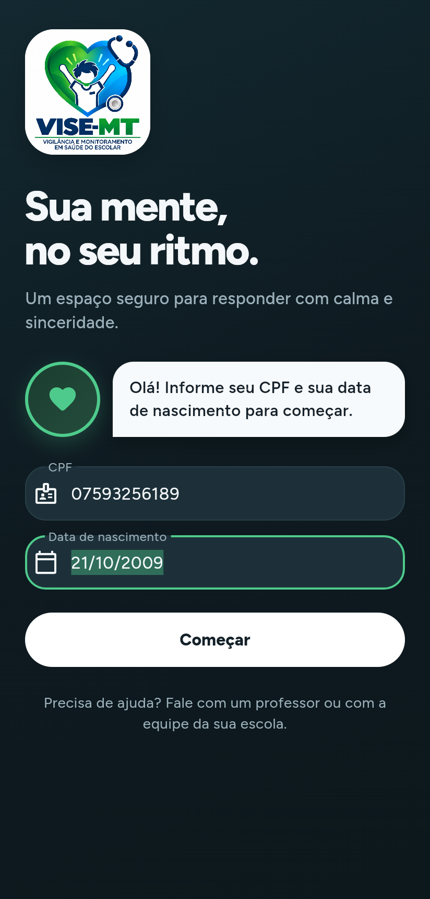
  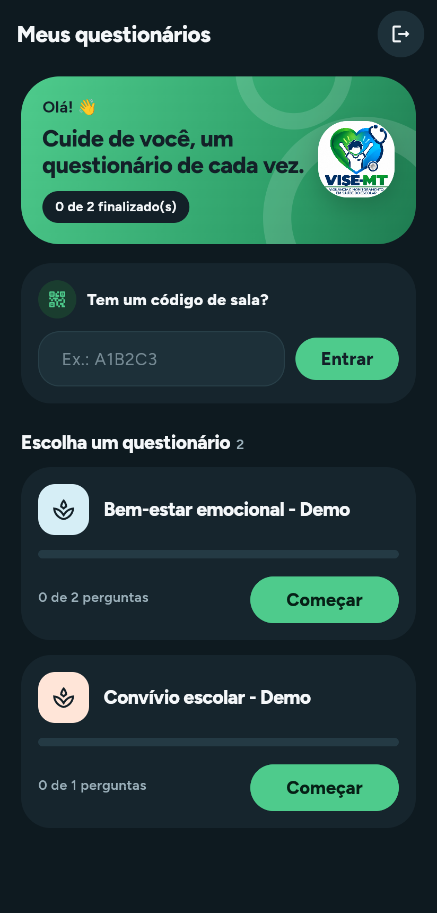
  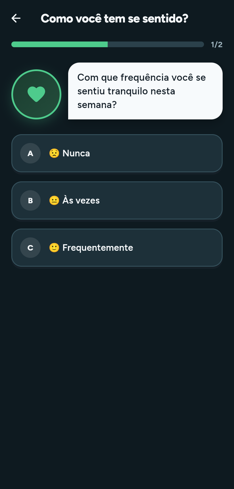
</p>
<p align="center"><em>Entrada · Login do aluno · Meus questionários · Pergunta (dados de demonstração)</em></p>

### 1.2 Escopo atual

| Incluído | Fora do escopo atual |
|----------|----------------------|
| Login do aluno por CPF + nascimento, termo de aceite | Recuperação de senha da equipe por e-mail |
| Questionários com categorias, perguntas, opções e pontuação | Exibir resultado ao aluno (por decisão de projeto) |
| Respostas offline com sincronização em lote | App iOS (não há projeto iOS gerado) |
| Salas por escola, turma ou aluno, com código e link | Notificações push / lembretes |
| Classificação automática por faixas de pontuação | Agendamento que abre/fecha sala sozinho |
| Painel de indicadores e alertas de alunos prioritários | Prontuário / encaminhamento clínico |
| Relatório Excel multi-abas, com anonimização | Integração com sistemas da Secretaria (SIGEDUCA etc.) |
| Importação por planilha (escolas, turmas, alunos, equipe) | Assinatura digital de termos |
| Importação do backup do sistema anterior | |
| Escola em foco (filtro que acompanha a sessão) | |
| Atualização OTA do app Android (Shorebird) | |

### 1.3 Números do projeto

| Indicador | Quantidade |
|-----------|-----------:|
| Tabelas no banco | 20 |
| Rotas da API (`/api/v1`) | 34 |
| Cadastros no painel (CRUD genérico) | 18 |
| Perfis da equipe | 3 + admin geral |
| Linhas de PHP (`src/`, `bin/`, `tests/`) | ≈ 12.000 |
| Linhas de Dart (`lib/`, sem código gerado) | ≈ 10.300 |
| Cenários de teste do backend / verificações | 30 / 638 |
| Testes do app (unitários + widget) | 16 |

Com os dados de demonstração (`--seed --seed-respostas=80`) o painel mostra 1 escola, 4 turmas, 81 alunos, 2 questionários, 2 salas ativas e cerca de 120 questionários concluídos.

### 1.4 Ambientes

| Ambiente | Painel | API | App |
|----------|--------|-----|-----|
| Produção | `https://visemt.com.br/api/admin` | `https://visemt.com.br/api/api/v1` | APK de release (já aponta para a produção) |
| Local (Docker) | `http://localhost:8000/admin` | `http://localhost:8000/api/v1` | `flutter run` (emulador usa `10.0.2.2`) |
| Local (PHP embutido) | `http://localhost:8000/admin` | `http://localhost:8000/api/v1` | `flutter run -d chrome` |

O backend de produção fica na **subpasta `/api`** do domínio; por isso a API tem `/api` duas vezes no endereço.

---

## 2. Arquitetura

### 2.1 Diagrama de componentes

```text
┌───────────────────────────────────────────────────────────────────────┐
│                 APP FLUTTER (Android + Web) — "VISE-MT"               │
│                                                                       │
│  Aluno: Entrada → Login → Termo → Questionários → Avatar → Caminho    │
│         → Perguntas → Fim                                             │
│  Equipe: Salas · Painel · Relatórios · Importar · Cadastros           │
│                                                                       │
│  AppController (Riverpod/ChangeNotifier)                              │
│     │                                                                 │
│     ├── Repositórios: auth · quiz · sync · staff · cadastros · painel │
│     │        │                       │                                │
│     │        ▼                       ▼                                │
│     │   ApiClient (Dio)        Drift (SQLite / IndexedDB na web)      │
│     │   Bearer + X-Auth-Token  cache do instrumento + fila (outbox)   │
│     │                                                                 │
│  flutter_secure_storage (token) · connectivity_plus (rede)            │
└──────────────┬────────────────────────────────────────────────────────┘
               │ HTTPS / JSON
               ▼
┌───────────────────────────────────────────────────────────────────────┐
│             BACKEND PHP 8 (index.php → App::router)                   │
│                                                                       │
│  /api/v1/*        Api\*Controller   (aluno: token opaco; equipe: JWT) │
│  /admin/*         Admin\*           (sessão + CSRF, HTML server-side) │
│  /install         Install\*         (protegido por INSTALL_KEY)       │
│                                                                       │
│  Services: Resultado · Indicadores · Relatório XLSX · Importação ·    │
│            Questionário · CódigoSala · Filtros                        │
│  Support:  XlsxReader/Writer · Zip · Planilha · Turmas · Tempo · Str  │
│                         │                                             │
│                         ▼                                             │
│                    Db (PDO) ──────▶ MySQL 5.7+ / MariaDB 10.3+        │
└───────────────────────────────────────────────────────────────────────┘
┌───────────────────────────────────────────────────────────────────────┐
│  Shorebird (nuvem): patches OTA do código Dart do app Android         │
└───────────────────────────────────────────────────────────────────────┘
```

### 2.2 Stack tecnológica

| Camada | Tecnologia | Versão |
|--------|-----------|--------|
| App | Flutter (canal stable) | 3.44.6 |
| Linguagem do app | Dart | SDK ^3.12.2 |
| Estado | flutter_riverpod | 2.6.1 |
| HTTP | dio | 5.11.0 |
| Banco local | drift + drift_flutter (SQLite; IndexedDB/WASM na web) | 2.34.3 / 0.3.1 |
| Armazenamento seguro | flutter_secure_storage | 11.0.0 |
| Conectividade | connectivity_plus | 7.3.1 |
| Tipografia | google_fonts (Figtree) | 6.3.3 |
| Compartilhar link / arquivo | share_plus · file_picker | 13.3.0 · 13.1.0 |
| OTA | shorebird_code_push | 2.0.7 |
| Lints | flutter_lints | 6.0.0 |
| Backend | PHP puro, sem Composer | 8.0+ (Docker usa 8.2) |
| Extensões PHP | `pdo_mysql`, `mbstring`, `zlib`, `simplexml` (a extensão `zip` não é necessária) | — |
| Banco | MySQL / MariaDB, `utf8mb4` | 5.7+ / 10.3+ (Docker usa MySQL 8.0) |
| Servidor web | Apache/LiteSpeed com `.htaccess`, Nginx ou `php -S` | — |
| Android build | Gradle 9.1.0 · AGP 9.0.1 · Kotlin 2.3.20 · Java 17 | — |
| OTA | Shorebird | app_id `ae92d476-922f-4f38-b2f0-2c892bad2f41` |

### 2.3 Princípios de projeto

- **Hospedagem simples:** o backend roda em qualquer hospedagem PHP compartilhada (cPanel), sem Composer, sem Node e sem processos em segundo plano. Planilhas XLSX e ZIP são lidos e escritos por código próprio (`src/Support`).
- **Offline primeiro para o aluno:** o instrumento é baixado no login e cada resposta é gravada no aparelho na hora; o envio ao servidor é em lote, quando há rede.
- **O aluno não vê pontuação:** pontos, pesos e classificação ficam só no servidor e nos relatórios da equipe.
- **Escola como tenant:** todo dado pertence a uma escola; a equipe só enxerga as escolas em que tem vínculo (o admin geral vê todas).
- **Um CRUD, duas interfaces:** os cadastros são descritos uma vez em `Admin/Resources.php` e servem tanto o painel web quanto o app da equipe (`/staff/cadastros`), com as mesmas permissões.
- **Instalação idempotente:** o instalador cria só o que falta e aplica migrações de colunas; pode ser rodado a cada atualização sem apagar dados.

---

## 3. Estrutura do repositório

```text
ViseSaudeMental/
├── README.md                       # Guia rápido
├── docker-compose.yml              # MySQL 8 + PHP 8.2/Apache para desenvolvimento
├── arquitetura_vise_sma_*.plan.md  # Plano de arquitetura original
├── docs/
│   ├── DOCUMENTACAO_VISE.md        # Este documento
│   ├── DOCUMENTACAO_VISE.pdf       # Versão PDF deste documento
│   ├── img/                        # Capturas de tela (geradas por tools/capturas.mjs)
│   ├── tools/                      # gerar-pdf.mjs, capturas.mjs, package.json
│   ├── openapi.yaml                # Contrato HTTP
│   ├── shorebird.md                # Passo a passo de release/patch OTA
│   ├── SPRINTS.md                  # Backlog e sprints
│   ├── Doc_Refatoracao_SMD.pdf     # Especificação de produto
│   └── alunos_exemplo.csv          # Exemplo de planilha de alunos
├── backend-php/
│   ├── index.php                   # Ponto de entrada (front controller)
│   ├── .htaccess                   # Roteamento, bloqueio de pastas, Authorization
│   ├── .env.example                # Configuração (copiar para .env)
│   ├── Dockerfile · docker/        # Imagem PHP 8.2 + Apache e entrypoint
│   ├── bin/
│   │   ├── install.php             # Instalador / migração por linha de comando
│   │   └── importar-legado.php     # Importa o backup .sql do sistema anterior
│   ├── database/schema.sql         # Esquema completo (idempotente)
│   ├── static/                     # admin.css e logo do painel
│   ├── tests/run.php               # Testes de integração (MySQL real)
│   └── src/
│       ├── App.php                 # Rotas, tratamento de erros e CORS
│       ├── bootstrap.php · Config.php · Db.php · Roles.php
│       ├── Http/                   # Request, Response, Router, Input, Url, HttpError
│       ├── Security/               # Jwt, AlunoTokens, Password
│       ├── Api/                    # Controladores da API (aluno e equipe)
│       ├── Admin/                  # Painel web: login, CRUD genérico, painel, escopo
│       ├── Services/               # Regras de negócio
│       ├── Support/                # XLSX, ZIP, planilhas, turmas, datas, textos
│       └── Install/                # Instalador, seed demo, importação do legado
└── mobile/
    ├── pubspec.yaml · shorebird.yaml · analysis_options.yaml
    ├── assets/branding/logo.jpeg   # Logo VISE-MT
    ├── tool/drift_worker.dart      # Worker do Drift para a web
    ├── web/                        # index.html, manifest, sqlite3.wasm, drift_worker.js
    ├── android/                    # Projeto Android (Kotlin DSL)
    ├── test/                       # Testes unitários e de widget
    └── lib/
        ├── main.dart · app.dart    # Entrada e escolha da tela (ViseApp)
        ├── core/                   # config/env.dart, network/api_client.dart, theme, shorebird, files
        ├── data/local/             # Drift: tables.dart, app_database.dart
        ├── data/repositories/      # auth, quiz, sync, staff, cadastros, painel
        ├── providers/              # app_providers.dart (AppController e providers)
        └── features/               # auth, termo, home, avatar, categories, questions,
                                    # finish, common, staff (salas, painel, cadastros)
```

---

## 4. Backend (API e painel em PHP)

### 4.1 Visão geral

Um único projeto PHP atende três superfícies:

| Superfície | Prefixo | Autenticação | Formato |
|-----------|---------|--------------|---------|
| API do aluno | `/api/v1` | Token opaco (`Bearer`) obtido com CPF + nascimento | JSON |
| API da equipe | `/api/v1/staff` | JWT HS256 (`Bearer`), validade padrão de 7 dias | JSON |
| Painel web | `/admin` | Sessão PHP (cookie `vise_admin`) + token CSRF nos POST | HTML |
| Instalador | `/install` | Chave `INSTALL_KEY` do `.env` | HTML |
| Saúde | `/up` | — | `{"status":"ok"}` |

O código não usa framework: `index.php` carrega `src/bootstrap.php` (autoload PSR-4 próprio do namespace `Vise\`), monta o `Request` e chama `App::handle`.

### 4.2 Módulos

| Pasta / arquivo | Responsabilidade |
|-----------------|------------------|
| `App.php` | Tabela de rotas, conversão de exceções em respostas (`{"detail": ...}` na API, página de erro no painel) e CORS |
| `Config.php` | Lê variáveis de ambiente e o `.env` (variáveis do servidor têm prioridade) |
| `Db.php` | PDO com helpers `one`, `all`, `value`, `insert`, `update`, `run`, `transaction`, `now()` (UTC) |
| `Roles.php` | Perfis da equipe e matriz de permissões (`read` / `write`) |
| `Http/` | `Request` (corpo JSON/form, cabeçalhos, `bearerToken`), `Response`, `Router` (padrões `{id:\d+}`), `Input` (validação), `Url` (base com subpasta) |
| `Security/` | `Jwt` (HS256 compatível com o antigo backend Python), `AlunoTokens` (token opaco guardado como SHA-256), `Password` (bcrypt, aceita `$2b$`) |
| `Api/` | `AuthController` (aluno), `AplicacoesController` (salas e instrumento), `RespostasController` (gravar e finalizar), `AlunoExtrasController` (avatar e termo), `StaffController` (equipe e salas), `CadastrosController` (CRUD genérico para o app), `PainelApiController` (painel, relatórios, importação), `Guard` |
| `Admin/` | `Auth` (sessão, CSRF, escola em foco), `Resources` (definição dos 18 cadastros), `Records` (consultas, filtros, relacionados), `CrudController`, `PainelController` (dashboard, relatórios, importação), `Scope` (quem vê o quê), `View` (layout HTML) |
| `Services/` | `ResultadoService`, `Indicadores`, `FiltrosRelatorio`, `OpcoesFiltro`, `RelatorioService`, `ImportacaoService`, `QuestionarioService`, `CodigoSala` |
| `Support/` | `XlsxReader`, `XlsxWriter`, `Zip`, `Planilha` (CSV/XLSX, Windows-1252), `Turmas` (série + turma), `Tempo` (UTC ↔ fuso), `Str` |
| `Install/` | `Installer` (schema + migrações), `Seed` (dados demo), `ImportLegado` (backup antigo), `InstallController` |

### 4.3 Ciclo de uma requisição

```text
index.php ──▶ Request::fromGlobals()
          ──▶ App::handle()
                 ├─ OPTIONS em /api → 204 + CORS
                 ├─ Router::dispatch() → Controller::método(Request)
                 │      └─ Guard::aluno / Guard::user / Auth::require (painel)
                 ├─ HttpError → JSON {"detail"} (API) ou página de erro (painel)
                 ├─ LoginRequired → redireciona para /admin/login
                 └─ Throwable → 500 (mensagem técnica só com APP_DEBUG=true; log em error_log)
          ──▶ Response::send() (+ CORS nas rotas /api e /up)
```

Sem `mod_rewrite`, a API responde em `/index.php/api/v1/...`.

### 4.4 Autenticação

**Aluno.** `POST /api/v1/login` com `cpf` (com ou sem máscara) e `data_nascimento` (`AAAA-MM-DD`). O servidor procura o aluno ativo com esse par e emite um **token opaco** de 40 bytes aleatórios. O banco guarda só o SHA-256 (`personal_access_tokens`). Cada novo login **apaga os tokens anteriores** do aluno, e o token não tem data de expiração.

**Equipe (app).** `POST /api/v1/staff/login` com `email` e `password` devolve um **JWT HS256** assinado com `SECRET_KEY`, com `sub` = id do usuário e `exp` = agora + `ACCESS_TOKEN_EXPIRE_MINUTES` (padrão 10.080 min = 7 dias). Tokens emitidos pelo antigo backend Python continuam válidos se a `SECRET_KEY` for a mesma.

**Painel web.** Login por formulário; sessão PHP com cookie `vise_admin` (`HttpOnly`, `SameSite=Lax`, `Secure` em HTTPS, caminho `/admin`, dura até fechar o navegador). Todo POST exige o campo `_csrf`. O ID da sessão é regenerado no login.

O app envia o token em `Authorization: Bearer` **e** em `X-Auth-Token`, porque algumas hospedagens descartam o cabeçalho `Authorization`.

### 4.5 CORS

Controlado por `CORS_ORIGINS`. Com `*` (padrão) qualquer origem acessa a API sem credenciais. Com uma lista separada por vírgulas, só essas origens recebem `Access-Control-Allow-Origin` (com `Allow-Credentials`). O preflight `OPTIONS` responde 204 com os métodos e cabeçalhos pedidos, cache de 600 s.

### 4.6 Endpoints do aluno

| Método | Rota | Auth | Descrição | Erros comuns |
|--------|------|------|-----------|--------------|
| POST | `/login` | — | CPF + nascimento → `{token, aluno}` | 422 CPF sem 11 dígitos ou "Credenciais inválidas." |
| POST | `/logout` | aluno | Revoga o token | 401 |
| GET | `/me` | aluno | Dados do aluno logado | 401 |
| POST | `/termos` | aluno | `{versao, texto_hash}` registra o aceite | 422 |
| GET | `/avatar` | aluno | Avatar da escola ou o global | — |
| GET | `/aplicacoes` | aluno | Salas ativas em que o aluno está no público + progresso | — |
| GET | `/salas/{codigo}` | — | Cartão público da sala ativa | 404 |
| POST | `/aplicacoes/entrar-com-codigo` | aluno | `{codigo}` → `aplicacao_id` (e talvez novo token) | 404 com o motivo |
| GET | `/aplicacoes/{id}/categorias` | aluno | Categorias do questionário da sala | 404 fora do público |
| GET | `/aplicacoes/{id}/categorias/{c}/perguntas` | aluno | Perguntas e opções, **sem pontuação nem peso** | 404 |
| POST | `/aplicacoes/{id}/respostas` | aluno | Uma resposta → `{status, id}` | 404 pergunta de outro questionário, 422 opção de outra pergunta |
| POST | `/aplicacoes/{id}/respostas/lote` | aluno | Até 500 respostas numa transação | 422 |
| POST | `/aplicacoes/{id}/finalizar` | aluno | Calcula o resultado → `{status: "concluido"}` | 422 faltam obrigatórias |

**Login do aluno**

```http
POST /api/v1/login
Content-Type: application/json

{ "cpf": "075.932.561-89", "data_nascimento": "2009-10-21" }
```

```json
{ "token": "-28hZt4OswSHnGbSTibYmaukTXUiHtWQ...", "aluno": { "id": 1, "nome": "Aluno Demo", "escola_id": 1 } }
```

**Salas do aluno**

```json
{
  "data": [
    { "id": 1, "questionario": { "id": 1, "nome": "Bem-estar emocional - Demo", "versao": 1 },
      "respondidas": 0, "total": 2, "concluido": false }
  ]
}
```

`respondidas` conta respostas gravadas, `total` conta perguntas ativas e `concluido` indica que já existe resultado. Não há pontuação.

**Perguntas de uma categoria**

```json
{
  "data": [
    {
      "id": 1, "categoria_id": 1, "subcategoria_id": null, "tipo": "multipla_escolha",
      "texto": "Com que frequência você se sentiu tranquilo nesta semana?",
      "ordem": 1, "obrigatoria": true, "imagem": null,
      "opcoes": [
        { "id": 1, "descricao": "Nunca", "ordem": 1, "cor": null, "emoji": "😟" },
        { "id": 2, "descricao": "Às vezes", "ordem": 2, "cor": null, "emoji": "😐" }
      ]
    }
  ]
}
```

**Corpo de uma resposta** (unitária ou item do lote): `pergunta_id` (obrigatório), `opcao_id`, `texto` (até 10.000 caracteres), `tempo_gasto_ms` (≥ 0), `dispositivo`, `responded_at` (ISO 8601), `client_uuid`.

**Entrar com código** — respostas possíveis:

| Situação | Resposta |
|----------|----------|
| Sala ativa, da escola do aluno, com ele no público | 200 `{aplicacao_id, questionario_nome, codigo}` |
| Outro cadastro com o **mesmo CPF e nascimento** se encaixa na sala | 200 com `token` e `aluno` novos; o app troca a sessão |
| Código inexistente | 404 "Não existe sala com o código X. Confira as letras e os números com o professor." |
| Sala encerrada | 404 pedindo um código novo |
| Sala de outra escola | 404 com o nome das duas escolas |
| Sala de outra turma | 404 com a turma da sala e a do aluno (ou "sem turma") |
| Sala para outro aluno | 404 "…foi criada para outro aluno." |

### 4.7 Endpoints da equipe

| Método | Rota | Descrição |
|--------|------|-----------|
| POST | `/staff/login` | `{email, password}` → `{token, user}` (com as escolas e perfis). 422 e-mail ou senha inválidos; 403 sem perfil de equipe ativo |
| GET | `/staff/me` | Usuário logado |
| GET | `/staff/questionarios?escola_id=` | Questionários **publicados** no escopo |
| GET | `/staff/turmas?escola_id=` | Turmas (professor: só as suas). `nome` = rótulo completo ("9º Ano A"), `turma` = identificação |
| GET | `/staff/salas?escola_id=` | Salas, mais recentes primeiro, com respondentes e concluídos |
| POST | `/staff/salas` | Cria sala ativa com código: `{questionario_id, escola_id, alvo_tipo, turma_id?}` |
| POST | `/staff/salas/{id}/encerrar` | Encerra a sala |
| GET | `/staff/cadastros` | Menu de cadastros permitidos ao perfil |
| GET / POST | `/staff/cadastros/{recurso}` | Lista (busca, filtros, página) / cria |
| GET | `/staff/cadastros/{recurso}/formulario` | Campos do formulário (tipos, opções, ajuda) |
| GET / POST | `/staff/cadastros/{recurso}/{id}` | Detalhe (com relacionados) / atualiza |
| POST | `/staff/cadastros/{recurso}/{id}/excluir` | Exclui |
| POST | `/staff/cadastros/{recurso}/acoes/{acao}` | Ação em lote `{ids: [...]}` (publicar, nova-versao, encerrar…) |
| GET | `/staff/painel` | Indicadores do recorte |
| GET | `/staff/relatorios/opcoes` | Filtros disponíveis e abas do relatório |
| GET | `/staff/relatorios/exportar` | Arquivo `.xlsx` |
| GET | `/staff/importacao` | Tipos de importação permitidos e colunas |
| GET | `/staff/importacao/{tipo}/modelo` | Planilha modelo |
| POST | `/staff/importacao/{tipo}` | Importa (ou simula) uma planilha |

**Criar sala**

```http
POST /api/v1/staff/salas
Authorization: Bearer <jwt>

{ "questionario_id": 1, "escola_id": 1, "alvo_tipo": "escola" }
```

```json
{
  "id": 3, "codigo": "3MBRNL", "link": "https://app.exemplo/?sala=3MBRNL", "status": "ativa",
  "alvo_tipo": "escola", "questionario_id": 1, "questionario_nome": "Bem-estar emocional - Demo",
  "escola_id": 1, "escola_nome": "Escola Demo Vise", "turma_id": null, "turma_nome": null,
  "inicia_em": null, "termina_em": null, "respondentes": 0, "concluidos": 0
}
```

O contrato completo está em [`docs/openapi.yaml`](openapi.yaml). Todos os erros seguem `{"detail": "mensagem"}`.

### 4.8 Serviços (regras de negócio)

| Serviço | O que faz |
|---------|-----------|
| `ResultadoService` | Soma `pontuação × peso` por categoria e aplica as regras de classificação (seção 6.5) |
| `QuestionarioService` | Publicar, nova versão, exigir perguntas antes de liberar sala, categoria padrão "Geral", propagar a escola do questionário ao conteúdo, limpar respostas de demonstração |
| `CodigoSala` | Gera códigos de 6 caracteres `A–Z0–9` únicos (até 40 tentativas) |
| `Indicadores` | Resumo, séries por dia/mês, níveis por categoria, participação por turma, aplicações e alertas — com escopo por perfil |
| `FiltrosRelatorio` · `OpcoesFiltro` | Interpretam os filtros (escola, turma, série, turno, sexo, questionário, aplicação, período) e montam as listas de opções |
| `RelatorioService` | Gera o Excel multi-abas (seção 6.9) |
| `ImportacaoService` | Importação de escolas, turmas, alunos e equipe por CSV/XLSX, com simulação |

### 4.9 Instalador e migrações

`php bin/install.php` (ou `/install` com `INSTALL_KEY`) executa `Installer::migrate()`:

1. roda `database/schema.sql` (só `CREATE TABLE IF NOT EXISTS`);
2. cria colunas que faltam em bancos antigos (`codigo_sala`, `regras_classificacao.nivel`), o índice `ix_resultados_created_at` e converte `termos_aceite.versao` para texto;
3. garante a chave única de turma `escola + série + turma` e remove a antiga `escola + nome`;
4. propaga a escola de cada questionário para categorias, subcategorias, perguntas, opções e regras;
5. renomeia turmas antigas que repetiam a série ("9º Ano A" → série 9º Ano, turma "A"), se não colidir.

Opções: `--admin=email --password=senha` cria/atualiza um admin geral; `--seed` cria os dados de demonstração; `--seed-respostas=N` cria N alunos simulados com respostas.

### 4.10 Configuração (`.env`)

| Variável | Padrão | Uso |
|----------|--------|-----|
| `APP_DEBUG` | `false` | Mostra a mensagem técnica nos erros 500 |
| `APP_TIMEZONE` | `America/Cuiaba` | Fuso de exibição (o banco grava em UTC) |
| `SECRET_KEY` | — | Assina os JWT da equipe. Longa e aleatória |
| `ACCESS_TOKEN_EXPIRE_MINUTES` | `10080` | Validade do JWT da equipe |
| `DB_HOST` / `DB_PORT` / `DB_NAME` / `DB_USER` / `DB_PASSWORD` | `localhost` / `3306` / `vise` / `vise` / — | Conexão MySQL |
| `CORS_ORIGINS` | `*` | Origens liberadas para o app web |
| `PUBLIC_APP_URL` | `http://localhost:8081` | Endereço do app web; monta o link `/?sala=CODIGO` |
| `INSTALL_KEY` | vazio | Libera o instalador web `/install`. Apague depois de usar |

---

## 5. Banco de dados (MySQL)

### 5.1 Convenções

- MySQL 5.7+ / MariaDB 10.3+, InnoDB, `utf8mb4_unicode_ci`. O esquema está em `backend-php/database/schema.sql` e é idempotente.
- Datas gravadas em **UTC**; painel e relatórios exibem em `APP_TIMEZONE`.
- A maioria das tabelas tem `created_at`, `updated_at` e `deleted_at`. O painel **apaga de verdade** (`DELETE`); a API do aluno ignora linhas com `deleted_at` preenchido (categorias, perguntas e opções).
- Quase todas as tabelas carregam `escola_id` (tenant), inclusive as do instrumento, para filtrar o escopo com um único índice.

### 5.2 Diagrama de entidades

```text
users ──< escola_user >── escolas ──< turmas >── series
  │                          │          │
  │                          │          └──< professor_turma >── users (professor)
  │                          ├──< alunos (turma_id opcional)
  │                          ├──< avatars (escola_id nulo = global)
  │                          └──< questionarios (pesquisador_id → users, parent_id → versão anterior)
  │                                   ├──< categorias ──< subcategorias
  │                                   │        └──< perguntas ──< opcoes_resposta
  │                                   ├──< regras_classificacao (por categoria)
  │                                   └──< aplicacoes_questionario (sala: alvo escola/turma/aluno)
  │                                              ├──< respostas  (aluno × pergunta)
  │                                              └──< resultados (aluno × aplicação)
  alunos ──< termos_aceite · personal_access_tokens (token do aluno)
  legado_map (chave do sistema antigo → id novo)
```

### 5.3 Tabelas organizacionais

| Tabela | Principais colunas | Regras |
|--------|--------------------|--------|
| `users` | `name`, `email` (único), `password` (bcrypt), `is_superuser` | Equipe. Admin geral ignora o escopo |
| `escolas` | `nome`, `municipio`, `uf`, `inep` (único), `responsavel`, `telefone`, `endereco`, `ativo` | Tenant |
| `escola_user` | `user_id`, `escola_id`, `role`, `status` (`ativo`…) | Vínculo e perfil; único por usuário + escola + perfil |
| `series` | `descricao` (única) | "6º Ano", "1ª Série"… compartilhadas entre escolas |
| `turmas` | `escola_id`, `serie_id`, `nome`, `turno` | `nome` é só a identificação ("A"); única por escola + série + nome. Turno: matutino, vespertino, noturno ou integral |
| `professor_turma` | `user_id`, `turma_id` | Turmas do professor |
| `alunos` | `nome`, `cpf` (11 dígitos), `data_nascimento`, `sexo`, `matricula`, `escola_id`, `turma_id`, `telefone`, `responsavel`, `contato_responsavel` | Login por CPF + nascimento. O CPF **não é único**: o mesmo aluno pode ter cadastro em mais de uma escola |

### 5.4 Tabelas do instrumento

**`questionarios`**

| Coluna | Tipo | Regra |
|--------|------|-------|
| `escola_id` | INT FK | tenant. Trocar a escola leva junto todo o conteúdo (`propagarEscola`) |
| `pesquisador_id` | INT FK `users` | dono; em branco no formulário = usuário logado |
| `nome` / `descricao` | VARCHAR / TEXT | nome obrigatório |
| `status` | VARCHAR(30) | `rascunho` (padrão) ou `publicado` |
| `publico_alvo` | VARCHAR(255) | texto livre (não filtra quem responde) |
| `versao` / `parent_id` | INT / FK | histórico de versões |
| `compartilhado_na_escola` | TINYINT | outros pesquisadores da escola podem ver e liberar em sala |

**`categorias`** — `questionario_id`, `nome`, `ordem`, `cor` (hex), `mensagem_avatar`, `imagem_apoio` (URL; o app baixa para disco no Android).

**`subcategorias`** — agrupamento opcional dentro da categoria (`categoria_id`, `nome`, `ordem`). O app do aluno não agrupa a tela por subcategoria.

**`perguntas`**

| Coluna | Regra |
|--------|-------|
| `categoria_id` | obrigatória no banco; no formulário é opcional (vai para a primeira categoria ou para "Geral") |
| `subcategoria_id` | opcional; tem de ser da mesma categoria |
| `tipo` | `multipla_escolha` ou `texto` |
| `texto` | enunciado |
| `ordem` | em branco = fim da categoria (`MAX(ordem)+1`) |
| `obrigatoria` | padrão 1; o servidor exige as obrigatórias ao finalizar |
| `peso` | DECIMAL, padrão 1.00; multiplica a pontuação. Não vai para o aluno |
| `imagem` | URL opcional |

**`opcoes_resposta`** — `pergunta_id`, `descricao`, `pontuacao` (pode ser negativa; **nunca vai para o aluno**), `ordem`, `cor`, `emoji`.

**`regras_classificacao`**

| Coluna | Regra |
|--------|-------|
| `categoria_id` | **é a coluna que o cálculo usa** |
| `questionario_id` | opcional; não há classificação do questionário inteiro |
| `min_score` / `max_score` | faixa inclusiva; `max ≥ min` |
| `rotulo` / `descricao` | texto livre ("Tranquilo", "Sinais de sofrimento") |
| `nivel` | `baixo`, `moderado` ou `alto`; vazio = "Sem nível" no painel |

### 5.5 Aplicação, respostas e resultados

**`aplicacoes_questionario`** (a sala)

| Coluna | Regra |
|--------|-------|
| `questionario_id` / `escola_id` | questionário da mesma escola |
| `alvo_tipo` | `escola`, `turma` ou `aluno` |
| `turma_id` / `aluno_id` | obrigatórios conforme o alvo; da mesma escola |
| `inicia_em` / `termina_em` | informativos: a API **não** bloqueia fora da janela |
| `status` | `ativa` (padrão) ou `encerrada` |
| `codigo_sala` | único, 6 caracteres `A–Z0–9`, gerado se vazio |

Sala ativa sem nenhuma pergunta é recusada no painel e no app.

**`respostas`** — uma linha por `(aplicacao_id, aluno_id, pergunta_id)`: `opcao_id`, `texto`, `tempo_gasto_ms`, `dispositivo`, `responded_at` (UTC), `client_uuid`. Se a mesma pergunta chegar de novo, fica a resposta com `responded_at` mais recente — uma sincronização atrasada não sobrescreve uma resposta mais nova.

**`resultados`** — uma linha por `(aplicacao_id, aluno_id)`:

- `totais_json`: `{ "<categoria_id>": <float> }`
- `classificacao_json`: `{ "<categoria_id>": { "rotulo", "descricao", "nivel" } | null }`

Refinalizar atualiza a mesma linha; `created_at` é a data da conclusão usada no painel.

### 5.6 Tabelas de apoio

| Tabela | Uso |
|--------|-----|
| `avatars` | `nome`, `imagem_path`, `mensagem_padrao`; `escola_id` nulo = avatar global |
| `termos_aceite` | Um por aluno + versão: `texto_hash` (SHA-256), IP, user-agent, `accepted_at` |
| `personal_access_tokens` | Tokens dos alunos (hash SHA-256), `last_used_at`, `expires_at` |
| `legado_map` | `chave` do sistema antigo → `novo_id`, para a importação não duplicar |

### 5.7 Dados de demonstração

`php bin/install.php --seed` cria a **Escola Demo Vise** (INEP `00000001`), séries 8º e 9º Ano com turmas A e B, os usuários demo (senha `password`) e dois questionários publicados, cada um com uma sala ativa alvo escola:

- **Bem-estar emocional - Demo** (compartilhado): categoria "Como você tem se sentido?" com uma pergunta de múltipla escolha (Nunca 0 😟, Às vezes 1 😐, Frequentemente 2 🙂) e uma de texto opcional; faixas 0 = Sinais de sofrimento (`alto`), 1 = Oscilando (`moderado`), 2 = Tranquilo (`baixo`).
- **Convívio escolar - Demo**: "Você se sente acolhido(a) na sua turma?" (Pouco 0, Mais ou menos 1, Bastante 2).

`--seed-respostas=80` cria alunos `SIM001…` com respostas fictícias (cerca de 22% sem resposta, alguns incompletos, o resto concluído), com semente fixa, para encher o painel e o Excel.

---

## 6. Perfis, permissões e regras de negócio

### 6.1 Perfis

| Perfil | O que faz |
|--------|-----------|
| **Admin geral** (`users.is_superuser`) | Tudo, em todas as escolas; cadastra escolas; importa escolas; limpa respostas de demonstração |
| **Admin da escola** (`admin_escola`) | Equipe, vínculos, séries, turmas, alunos, salas e avatares da escola; lê questionários e resultados |
| **Pesquisador** (`pesquisador`) | Monta questionários (categorias, perguntas, opções, regras), publica, cria versões e libera salas |
| **Professor** (`professor`) | Consulta as próprias turmas, alunos, salas e resultados; cria sala só para as suas turmas (pelo app) |
| **Aluno** | Entra no app com CPF + nascimento e responde |

### 6.2 Matriz de permissões (`Roles.php`)

`write` inclui criar, editar e excluir.

| Recurso | Admin da escola | Pesquisador | Professor |
|---------|-----------------|-------------|-----------|
| Escola | leitura | — | — |
| Usuários e vínculos | escrita | — | — |
| Professor × turma | escrita | — | — |
| Séries e turmas | escrita | — | turma: leitura |
| Alunos | escrita | — | leitura |
| Questionário | leitura | escrita | — |
| Categoria, subcategoria, pergunta, opção, regra | — | escrita | — |
| Aplicação (sala) | escrita | escrita | leitura |
| Respostas e resultados | leitura | leitura | leitura |
| Avatar | escrita | leitura | — |
| Termo de aceite | leitura | — | — |

**Escopo (`Scope.php`).** O pesquisador vê os **próprios** questionários e os **compartilhados na escola**; editar, excluir, publicar e criar versão só nos seus. O professor vê salas da escola inteira, das suas turmas ou de alunos dessas turmas.

### 6.3 Turma = série + identificação

- No formulário: **Escola → Série** (ex.: 6º Ano) **→ Turma** (só a identificação: A, B, 601) **→ Turno**.
- Em todo o sistema a turma aparece como **"6º Ano A"** (`Turmas::rotulo` / `Turmas::sql`).
- Se alguém digitar "6º Ano B" no campo Turma, a série é retirada e grava-se "B". Duplicadas na mesma escola e série são recusadas ("Já existe a turma 6º Ano B nesta escola.").
- Importação e o backup antigo entendem "6 ano B" numa coluna só (`Turmas::separar`, `Turmas::encontrar`). Um nome sem série que exista em mais de uma série é recusado como ambíguo.

### 6.4 Montar o instrumento

1. Criar o **questionário** (rascunho) na escola.
2. No detalhe do questionário, em **Perguntas → + adicionar**, criar as perguntas. A categoria é opcional (sem ela, entra na primeira categoria ou numa categoria **Geral** criada automaticamente). As opções são digitadas uma por linha:

```text
Nunca = 0
Às vezes = 1
Frequentemente = 2
Sempre = 3
```

   Também valem `Texto; 1`, `Texto | 1`, `Texto : 1` e sufixos `pt`, `pts`, `pontos`. Linha só com texto recebe a posição como pontuação (0, 1, 2…). Múltipla escolha nova exige ao menos duas opções.
3. Cadastrar as **regras de classificação** de cada categoria (faixas + rótulo + nível).
4. **Publicar** (só `rascunho → publicado`; publicar não exige perguntas, liberar sala exige).
5. **Liberar em sala** (painel ou app).

**Nova versão** (só de um publicado) copia numa transação o questionário (`versao + 1`, rascunho, `parent_id`), categorias, subcategorias, perguntas, opções e regras. O original e suas salas continuam intactos. **A cópia da regra não leva o `nivel`** — preencha de novo.

### 6.5 Pontuação e classificação

Executado em `POST /aplicacoes/{id}/finalizar`, depois de conferir as obrigatórias:

```text
pontos = pontuação da opção escolhida (0 para texto livre ou opção apagada)
total[categoria] += pontos × peso da pergunta        (peso nulo = 1)
```

Para cada categoria respondida, vale a primeira regra (por `id`) com `min_score ≤ total ≤ max_score`. Sem faixa que cubra o total, a classificação daquela categoria fica `null`.

O **nível do aluno** no painel é o pior entre as categorias: `alto` (Prioritário) > `moderado` (Atenção) > `baixo` (Adequado). "Sem nível" não compete. Um aluno prioritário não é contado de novo em atenção.

| `nivel` | Rótulo no painel e no Excel |
|---------|------------------------------|
| `baixo` | Adequado (sem sinal de risco) |
| `moderado` | Atenção (acompanhar) |
| `alto` | Prioritário (intervir) |
| vazio | Sem nível |

Resultados antigos sem `nivel` no JSON são completados na leitura pela regra atual de mesmo rótulo.

### 6.6 Sala (aplicação) e código

- Código: 6 caracteres `A–Z0–9`. Na entrada, o texto é posto em maiúsculas e perde o que não for letra ou número (aceita 4 a 12 caracteres).
- Link: `{PUBLIC_APP_URL}/?sala={CODIGO}`. No app web, o `?sala=` fica pendente e, depois do login do aluno, entra sozinho na sala.
- **Quem entra:** sala `ativa`, da escola do aluno, e o alvo inclui o aluno (`escola` = todos; `turma` = mesma turma; `aluno` = ele).
- **Criar pelo app:** questionário publicado da mesma escola; pesquisador só o próprio ou compartilhado; professor só alvo turma e só as suas turmas; o questionário precisa ter pergunta ativa. A escola usada é a do questionário escolhido (ou a escola em foco).
- **Encerrar:** a sala some para o aluno; respostas ficam guardadas.

### 6.7 Escola em foco

Para quem enxerga mais de uma escola (admin geral ou equipe com vários vínculos):

- No painel web, um seletor no topo (`/admin/foco`); no app, um cartão no menu lateral.
- Abrir uma escola, ou um registro de uma escola, muda o foco.
- Listas (alunos, turmas, salas, equipe, professores × turmas, perguntas…), formulários novos, painel e relatórios passam a abrir filtrados pela escola em foco durante a sessão.
- "Todas as escolas" (ou o × no filtro) limpa o foco. Um filtro explícito diferente na URL tem prioridade.

### 6.8 Importação por planilha

Disponível em `/admin/importar` e no app (**Importar planilha**), em `.xlsx` ou `.csv` (UTF-8 ou Windows-1252), até 10.000 linhas, com **planilha modelo** por tipo e botão **Simular** (valida sem gravar).

| Tipo | Chave para atualizar | Colunas obrigatórias | Opcionais |
|------|---------------------|----------------------|-----------|
| Escolas (admin geral) | INEP | Nome, Município, UF | INEP, Responsável, Telefone, Endereço |
| Turmas | escola + série + turma | Escola (nome ou INEP), Série, Turma | Turno |
| Alunos | escola + CPF | Escola, Nome, CPF, Data de nascimento, Turma | Série, Turno, Sexo, Matrícula, Telefone, Responsável, Contato do responsável |
| Equipe | e-mail | Escola, Nome, E-mail, Perfil | Senha inicial (obrigatória para novos), Turmas do professor (separadas por ";") |

Os cabeçalhos aceitam variações (`nome_aluno`, `nascimento`, `inep`, `ano`…). CPFs que perderam zeros à esquerda no Excel são corrigidos. Com Série e Turno preenchidos, a turma do aluno é criada se não existir.

### 6.9 Painel e relatório Excel

**Filtros:** escola, turma, série, turno, sexo, questionário, aplicação e período (`7`, `30`, `90`, `365` dias, `tudo` ou personalizado). O painel abre em 30 dias; o Excel em "tudo".

**Resumo:** alunos, turmas e escolas do recorte; participantes; participação (0–1); concluídos; em andamento; respostas; salas ativas; prioritários; atenção; última conclusão. Mais: conclusões por dia (até 62 dias) ou por mês, níveis por categoria, participação por turma (menor primeiro), até 10 salas e até 10 alertas de alunos prioritários.

**Abas do Excel:**

| Chave | Aba | Padrão | Conteúdo |
|-------|-----|--------|----------|
| `resumo` | Resumo | sempre | filtros, indicadores e faixas |
| `escolas` | Por escola | sim | participação e níveis |
| `turmas` | Por turma | sim | participação, pendências e níveis |
| `classificacao` | Classificação | sim | alunos por faixa de cada categoria |
| `alunos` | Resultados por aluno | sim | pontuação e classificação por categoria |
| `perguntas` | Respostas por pergunta | sim | quantidade e % de cada opção |
| `pendentes` | Pendentes | não | alunos de salas ativas sem resultado, com telefone e responsável (até 20.000) |
| `respostas` | Respostas detalhadas | não | uma linha por resposta (até 50.000) |

**Anonimizar alunos** troca nomes por códigos e remove CPF, matrícula e contatos.

### 6.10 Importação do sistema anterior

`ImportLegado` lê o backup `.sql` do sistema antigo (tabelas `aluno`, `escola`, `categoria_pergunta`, `pergunta`, `respostas`…), pela tela `/install` ou por `php bin/importar-legado.php backup.sql [--aplicar] [--pesquisador=email]`:

- cada `categoria_pergunta` antiga vira um **questionário publicado** (com uma categoria), copiado para cada escola que o usava;
- perguntas com opções viram múltipla escolha obrigatória; sem opções, texto opcional;
- regras `verde` → `baixo` (Adequado); `amarelo`/`laranja` → `moderado`; `vermelho` → `alto` (Prioritário);
- respostas vão para uma sala **encerrada** com as datas originais; quem completou ganha resultado calculado;
- os alunos continuam entrando com o mesmo CPF e nascimento;
- o relatório aponta CPFs ausentes, inválidos ou repetidos e turmas sem nome. Pode ser repetida sem duplicar (`legado_map`).

---

## 7. Aplicativo (Flutter)

### 7.1 Identificação do app

| Plataforma | Nome exibido | Identificador |
|------------|--------------|---------------|
| Android | Vise Saúde Mental | `br.com.vise.vise_sma_app` |
| Web (PWA) | Vise Saúde Mental (curto: "Vise SMA") | — |
| Título interno (`MaterialApp`) | VISE-MT | — |
| Pacote Dart | `vise_sma_app` | — |

Projetos gerados: Android e Web. Não há projeto iOS.

### 7.2 Camadas

| Camada | Arquivos | Papel |
|--------|----------|-------|
| Entrada | `main.dart`, `app.dart` | Inicia o Shorebird em segundo plano e cria `ViseApp`, que escolhe a tela pelo estado |
| Configuração | `core/config/env.dart` | URL da API |
| Rede | `core/network/api_client.dart` | Dio com timeouts de 8 s (conexão) e 15 s (resposta), token em `Authorization` e `X-Auth-Token` |
| Banco local | `data/local/tables.dart`, `app_database.dart` | Drift (schema v2): cache do instrumento, progresso e fila de envio |
| Repositórios | `data/repositories/*.dart` | `auth`, `quiz` (cache e respostas), `sync` (envio e finalização), `staff` (salas), `cadastros` (CRUD genérico), `painel` (indicadores, relatórios, importação) |
| Estado | `providers/app_providers.dart` | `AppController` (`ChangeNotifier` via Riverpod) e providers de repositório; `escolaFocoProvider` |
| Telas | `features/**` | Aluno e equipe |
| Tema | `core/theme/app_theme.dart` | Tema escuro com menta e pastéis |

### 7.3 URL da API

```dart
static String get baseUrl {
  if (_override.isNotEmpty) return _override;          // --dart-define=API_BASE_URL=...
  if (kReleaseMode) return producao;                   // https://visemt.com.br/api/api/v1
  if (kIsWeb) return 'http://localhost:8000/api/v1';
  return 'http://10.0.2.2:8000/api/v1';                // emulador Android
}
```

| Ambiente | URL base |
|----------|----------|
| Release sem `dart-define` | `https://visemt.com.br/api/api/v1` |
| Debug web | `http://localhost:8000/api/v1` |
| Debug emulador Android | `http://10.0.2.2:8000/api/v1` |
| Aparelho físico | `--dart-define=API_BASE_URL=http://<IP-da-máquina>:8000/api/v1` |

### 7.4 Navegação

A navegação principal não usa rotas nomeadas: `ViseApp._home` decide a tela a partir do `AppController`:

```text
inicializando ─▶ carregando
não autenticado ─▶ RoleGateScreen ("Sou aluno" / "Sou da equipe")
modo equipe ─▶ StaffShell (menu em gaveta no celular, lateral fixo a partir de 900 px)
aluno sem termo ─▶ TermoScreen
aluno sem sala aberta ─▶ HomeQuestionariosScreen
sala aberta, sem introdução ─▶ AvatarIntroScreen (uma vez por aluno + sala)
sala aberta ─▶ CategoriesScreen ("Caminho") ─▶ QuestionScreen ─▶ FinishScreen
```

A largura máxima é 560 px para o aluno e 1.440 px para a equipe (`ResponsiveShell`).

### 7.5 Fluxo do aluno

<p align="center">
  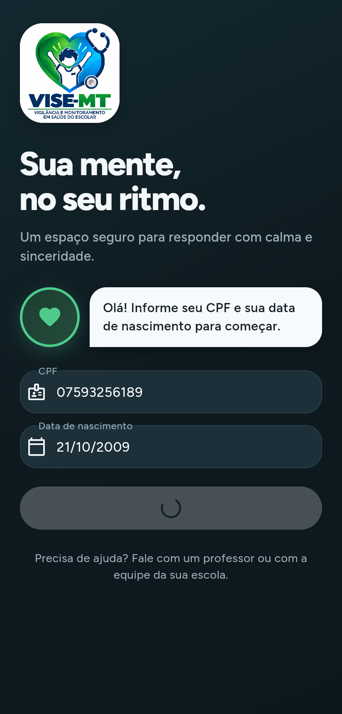
  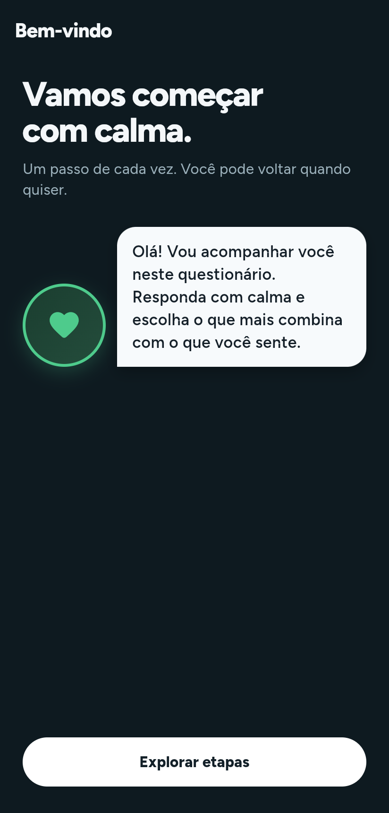
  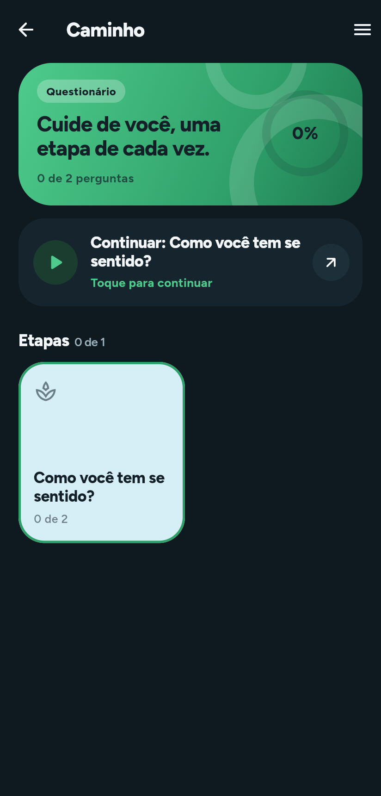
  
</p>
<p align="center"><em>Termo · Introdução do avatar · Caminho (etapas) · Pergunta</em></p>

1. **Entrada** — escolhe "Sou aluno".
2. **Login** — CPF e data de nascimento (calendário). Com rede, chama `/login` e baixa o instrumento de todas as salas; sem rede, usa a sessão e o cache.
3. **Termo** — "Li e aceito participar" (versão 1.0). Se o envio falhar, o aceite fica guardado no aparelho.
4. **Meus questionários** — cartões com o progresso de cada sala e o campo **"Tem um código de sala?"**.
5. **Avatar** — apresentação ("Vamos começar com calma"), uma vez por sala.
6. **Caminho** — etapas (categorias) com progresso; "Continuar" abre a primeira pergunta sem resposta.
7. **Pergunta** — o avatar faz a pergunta; opções com letra e emoji, ou campo de texto. Cada toque grava no aparelho.
8. **Concluir** — aparece quando todas as perguntas têm resposta local; a tela "Pronto" envia ao servidor (botão **Enviar ao servidor** se falhar).

### 7.6 Offline: cache e sincronização

| Tabela Drift | Conteúdo |
|--------------|----------|
| `CachedAplicacao` | sala, título, `concluidaLocalmente`, `sincronizadaServidor` |
| `CachedCategoria` | `(aplicacaoId, id)`, título, mensagem, imagem, ordem |
| `CachedPergunta` | pergunta, categoria, texto, tipo, obrigatória, imagem, ordem |
| `CachedOpcao` | opção, descrição, emoji, ordem (sem pontuação) |
| `LocalProgress` | `(aplicacaoId, perguntaId)` → JSON da resposta |
| `OutboxResposta` | fila: `clientUuid`, payload, status `pendente` / `enviando` / `sincronizada` / `erro` |

`SyncRepository.sincronizar(aplicacaoId)`:

```text
sem rede ──▶ estado "local" (nada é perdido)
com rede ──▶ POST /respostas/lote  (outbox ≠ sincronizada, até 500 por lote)
         ──▶ se concluída localmente e não sincronizada: POST /finalizar
         ──▶ sucesso: outbox "sincronizada", sala "sincronizadaServidor"
         ──▶ falha: outbox "erro"; tenta de novo depois
```

O envio também dispara ao recuperar a rede e ao sair da conta. Salas encerradas saem do cache, **exceto** se ainda tiverem respostas a enviar. Quando outro aluno entra no mesmo aparelho, o cache do anterior é apagado (`limparDadosLocais`); como a saída tenta enviar tudo antes, só se perde o que não pôde ser enviado por falta de rede.

Na web, o Drift usa `sqlite3.wasm` + `drift_worker.js` com IndexedDB; imagens são exibidas por `Image.network`.

### 7.7 Área da equipe

<p align="center">
  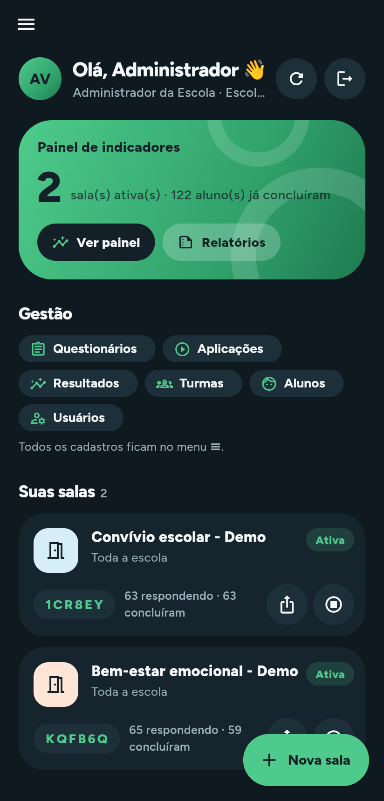
</p>
<p align="center" class="largo">
  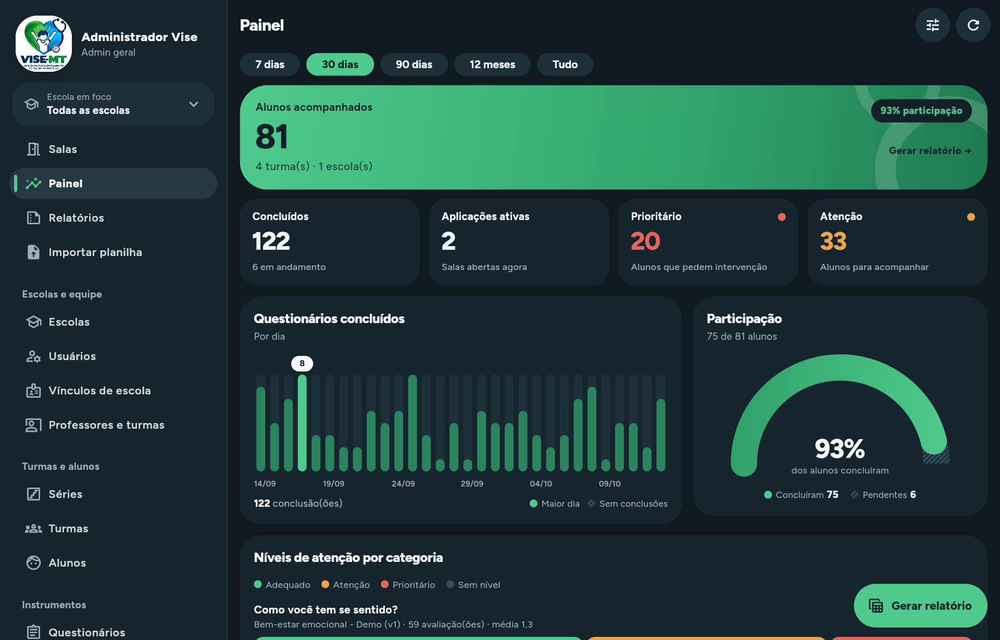
</p>
<p align="center"><em>Salas no celular · Painel no tablet (menu lateral fixo com a escola em foco)</em></p>

| Tela | Conteúdo |
|------|----------|
| **Salas** (início) | Cartão de indicadores, atalhos de gestão, lista de salas com código, respondentes e concluídos; **Nova sala**, compartilhar link, encerrar |
| **Criar sala** | Questionário publicado, alvo (escola ou turma), turma; gera código e link |
| **Painel** | Mesmos indicadores do painel web; filtros de período; turma abre o relatório filtrado |
| **Relatórios** | Filtros e abas; baixa o `.xlsx` (no Android, abre a planilha de compartilhamento; na web, baixa o arquivo) |
| **Importar planilha** | Tipo, colunas esperadas, modelo, simular e importar |
| **Cadastros** | Lista, detalhe (com relacionados e ações) e formulário genéricos, montados a partir de `/staff/cadastros` |
| **Escola em foco** | Cartão no menu lateral para quem vê mais de uma escola |

### 7.8 Identidade visual (`AppTheme`)

Tema escuro (Material 3) inspirado em apps de bem-estar, sem ranking/XP.

| Token | Cor | Uso |
|-------|-----|-----|
| `background` | `#0E1A20` | fundo |
| `surface` / `surfaceRaised` / `surfaceSoft` | `#16252D` / `#1D3039` / `#243A44` | cartões e superfícies |
| `border` | `#35515C` | bordas |
| `mint` | `#4ECB8C` | cor primária, botões, progresso |
| `mintDeep` | `#2FA06A` | gradiente do cartão de destaque |
| `text` / `muted` | `#F4F7F9` / `#9BB0BA` | textos |
| `bubble` | `#F7FAFC` | balão de fala do avatar |
| `warn` | `#E8A54B` | atenção |
| Pastéis | `#D6EEF6`, `#FFE5D8`, `#D9F3E4`, `#F3EEDF`, `#F6E2EA`, `#EAF5D2` | cartões de etapa (por índice) |

Tipografia **Figtree** (google_fonts). Raios 14/20/28/36 px. O painel web usa a mesma paleta em tema claro (`static/admin.css`).

### 7.9 Componentes reutilizáveis (`features/common`)

| Componente | Descrição |
|------------|-----------|
| `TactileButton` | Botão principal com efeito de pressão |
| `AvatarBubble` | Avatar com balão de fala |
| `BrandAndProgress` | Logo e barras de progresso |
| `ResponsiveShell` | Centraliza e limita a largura |
| `ui_kit.dart` | Cartões, cabeçalhos, estados de carregando/erro/vazio, `mensagemDeErro` |
| `escola_foco.dart` | Seletor e regras da escola em foco |
| `compartilhar_sala.dart` | Copiar/compartilhar o link da sala |

### 7.10 Permissões e plataformas

| Configuração | Motivo |
|--------------|--------|
| `android.permission.INTERNET` | Acesso à API |
| `android:usesCleartextTraffic="true"` | Permite HTTP (API local em desenvolvimento) |
| `android:label="Vise Saúde Mental"` | Nome no launcher |
| Assinatura de release | Hoje usa a chave de **debug** (ver seção 15) |
| `minSdk` / `targetSdk` | Herdados do Flutter |

---

## 8. Painel web (`/admin`)

O painel é HTML gerado no servidor (`Admin/View.php` + `static/admin.css`), sem JavaScript de framework. Menu:

| Grupo | Itens |
|-------|-------|
| Menu | Início (dashboard) |
| Relatórios e dados | Relatórios (Excel), Importar planilha |
| Escolas e equipe | Escolas, Usuários, Vínculos de escola, Professores e turmas |
| Turmas e alunos | Séries, Turmas, Alunos |
| Instrumentos | Questionários, Categorias, Subcategorias, Perguntas, Opções de resposta, Regras de classificação |
| Aplicação e dados | Aplicações, Respostas, Resultados, Termos aceitos, Avatares |

Cada perfil vê só os itens que pode acessar.

<p align="center" class="largo">
  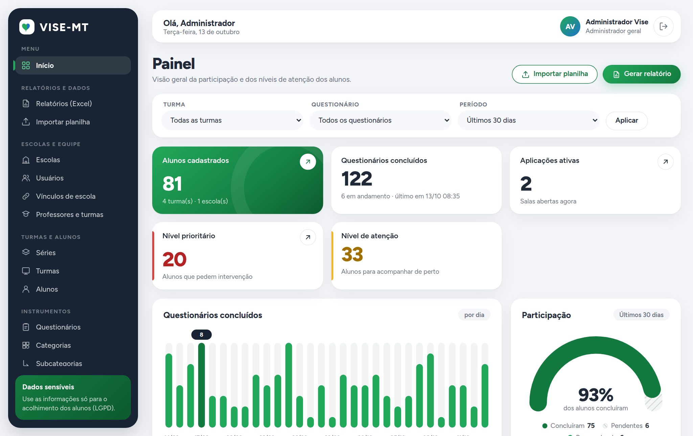
</p>
<p align="center"><em>Dashboard: indicadores, níveis de atenção, conclusões por dia e participação</em></p>

**CRUD genérico.** Toda listagem tem busca, filtros (chips removíveis), paginação, ações em lote e **Exportar Excel** respeitando os filtros. O detalhe mostra os campos e o bloco **Relacionados** (o que aponta para o registro, com contagem e "+ adicionar"). Ações específicas: questionários (*Publicar*, *Nova versão*) e aplicações (*Encerrar*, *Limpar respostas (demo)* — só admin geral).

<p align="center" class="largo">
  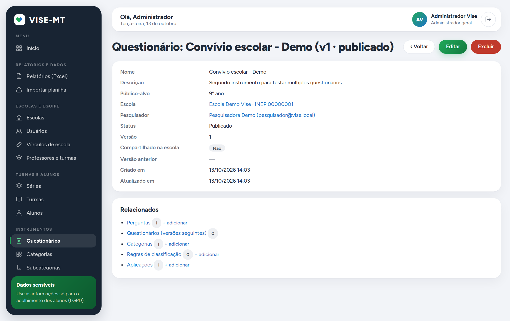
</p>
<p align="center"><em>Detalhe do questionário: "Perguntas + adicionar" logo no topo dos relacionados</em></p>

<p align="center" class="largo">
  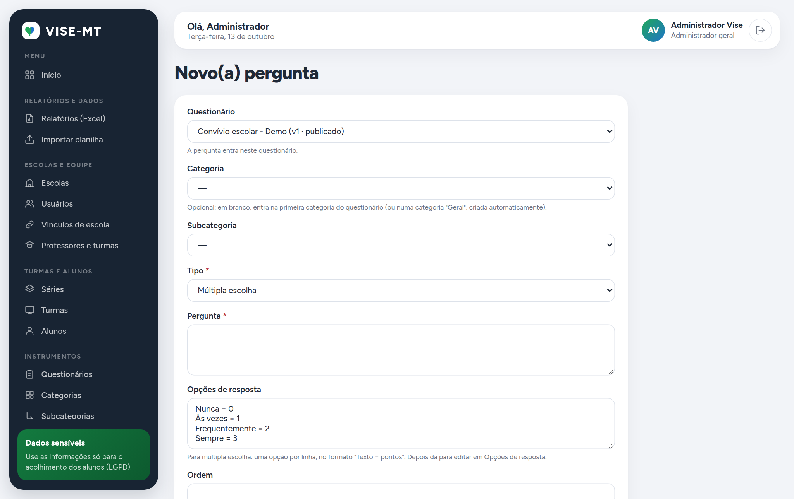
</p>
<p align="center"><em>Nova pergunta criada a partir do questionário: categoria opcional e opções digitadas como texto</em></p>

<p align="center" class="largo">
  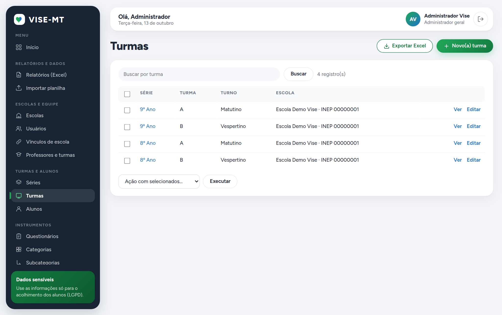
</p>
<p align="center"><em>Turmas: série e turma em colunas separadas</em></p>

<p align="center" class="largo">
  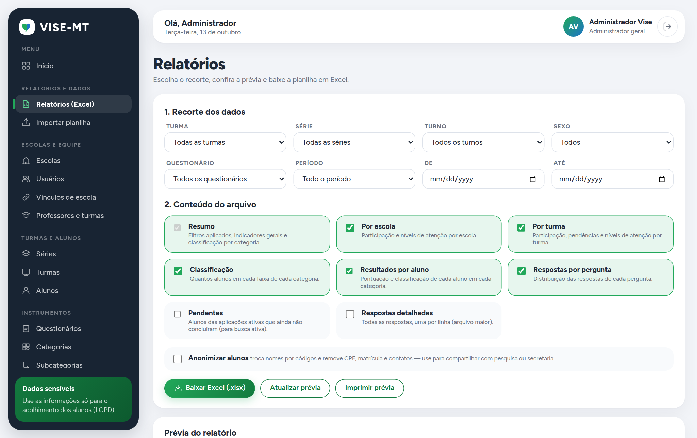
</p>
<p align="center"><em>Relatórios: recorte, abas do arquivo, anonimização e prévia</em></p>

<p align="center" class="largo">
  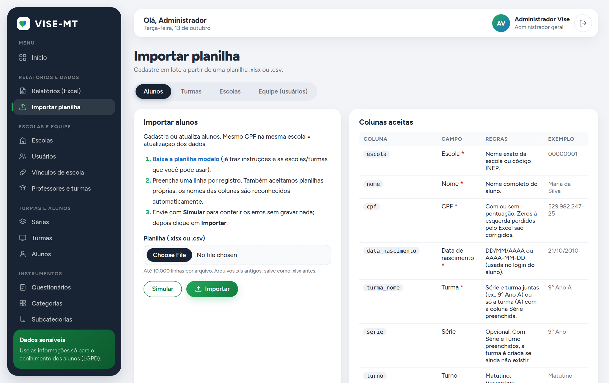
</p>
<p align="center"><em>Importação: tipo, colunas esperadas, planilha modelo e simulação</em></p>

---

## 9. Atualizações OTA com Shorebird

O Shorebird envia correções de código Dart direto aos aparelhos Android, sem nova publicação na loja. **A versão web não usa Shorebird** — basta publicar o novo `build/web`.

- Configuração: `mobile/shorebird.yaml` com `app_id: ae92d476-922f-4f38-b2f0-2c892bad2f41` (público; fica versionado). O arquivo é asset no `pubspec.yaml`.
- `auto_update` no padrão: o app baixa o patch em segundo plano e aplica na próxima abertura. `ShorebirdService.verificarEmBackground()` só registra o patch atual no log.

### 9.1 Fluxo de trabalho

```bash
shorebird login                  # uma vez
cd mobile
shorebird release android        # release base (AAB) que vai para a loja
shorebird patch android          # patch OTA para a release correspondente
shorebird releases list · shorebird patches list
```

O release sem `--dart-define` já usa a API de produção. Se usar outra URL, repita **o mesmo** `--dart-define` no patch.

### 9.2 O que pode e o que não pode ir por patch

| Pode (patch OTA) | Não pode (exige nova release) |
|------------------|-------------------------------|
| Telas, textos e lógica em Dart | Código nativo (Kotlin), `AndroidManifest.xml` |
| Ajustes de tema e layout | Plugins novos com código nativo |
| Correções nos repositórios e no `AppController` | Ícone, nome do app, permissões |
| | Novos assets obrigatórios; troca da versão do Flutter do Shorebird |

Detalhes em [`docs/shorebird.md`](shorebird.md).

---

## 10. Instalação e execução

### 10.1 Pré-requisitos

| Ferramenta | Uso |
|-----------|-----|
| Docker + Docker Compose | Ambiente local completo (opção mais simples) |
| PHP 8.0+ (`pdo_mysql`, `mbstring`, `zlib`, `simplexml`) e MySQL 5.7+/MariaDB 10.3+ | Backend sem Docker |
| Flutter 3.44+ (Dart 3.12+) | App |
| Android Studio + SDK / emulador | Android |
| Node 18+ e Chrome/Chromium (opcional) | Gerar o PDF e as capturas desta documentação |
| Shorebird CLI (opcional) | Releases e patches OTA |

### 10.2 Backend com Docker

```bash
docker compose up --build -d
```

O container (PHP 8.2 + Apache) espera o MySQL, cria/atualiza as tabelas, roda o seed de demonstração e atende em `http://localhost:8000`. O MySQL fica na porta **3307** (usuário `vise` / `vise`, root `root`).

### 10.3 Backend sem Docker

```bash
cd backend-php
cp .env.example .env              # ajuste DB_* e SECRET_KEY
php bin/install.php --seed        # tabelas + dados demo
php -S 0.0.0.0:8000 index.php
```

| Recurso | Endereço / dado |
|---------|-----------------|
| Saúde | `http://localhost:8000/up` |
| Painel | `http://localhost:8000/admin` |
| API | `http://localhost:8000/api/v1` |
| Admin geral | `admin@vise.local` / `password` |
| Admin da escola | `admin.escola@vise.local` / `password` |
| Pesquisador | `pesquisador@vise.local` / `password` |
| Professor | `professor@vise.local` / `password` |
| Aluno demo | CPF `07593256189` · nascimento `21/10/2009` |

### 10.4 App

```bash
cd mobile
flutter pub get
flutter run -d chrome                                            # web → localhost:8000
flutter run                                                      # emulador Android → 10.0.2.2:8000
flutter run --dart-define=API_BASE_URL=http://192.168.1.10:8000/api/v1   # aparelho físico
```

Depois de mudar `lib/data/local/tables.dart`, gere o código do Drift e suba o `schemaVersion` com a migração:

```bash
dart run build_runner build --delete-conflicting-outputs
```

---

## 11. Testes

### 11.1 Backend — testes de integração

`backend-php/tests/run.php` sobe o servidor embutido do PHP, **recria as tabelas do banco informado** a cada cenário e exercita API, painel e serviços contra um MySQL real.

```bash
TEST_DB_HOST=127.0.0.1 TEST_DB_PORT=3307 TEST_DB_NAME=vise_test \
TEST_DB_USER=root TEST_DB_PASSWORD=root php backend-php/tests/run.php [filtro]
```

Use um banco **só para testes**. Última execução: **638 verificações ok, 0 falhas**, em 30 cenários:

| Área | Cenários |
|------|----------|
| Aluno | login com CPF mascarado; data errada / CPF inválido; fluxo completo; não acessa sala de outra escola; resultado via serviço |
| Equipe (API) | login e criação de sala; login inválido; hash bcrypt `$2b$` do Python; CORS e rotas utilitárias |
| Cadastros pelo app | pesquisador monta questionário e libera sala; admin da escola e professor |
| Instrumento | publicar só rascunho; nova versão copia opções; perguntas criadas direto do questionário |
| Salas | limpar aplicação remove respostas e resultados; mensagens claras e cadastro duplicado |
| Painel web | todas as páginas por perfil; criar, editar, ações e escopo; importação CSV; dashboard, relatórios, exportações e importação; escola em foco acompanha a sessão |
| Planilhas | XLSX escrita/leitura e CSV Windows-1252; alunos por XLSX com simulação, INEP e CPF sem zeros; turmas, escolas e equipe; CSV com coluna escola; CSV fora do escopo |
| Indicadores | níveis, filtros e escopo do professor; API staff (painel, opções, relatório, importação) |
| Outros | importar backup do sistema anterior; turma = série + identificação |

### 11.2 App

```bash
cd mobile
flutter analyze      # sem avisos
flutter test         # 16 testes
```

| Arquivo | O que cobre |
|---------|-------------|
| `api_client_test.dart` | Leitura de listas `{data: [...]}` |
| `auth_login_test.dart` | Login online/offline, token guardado, troca de aluno descarta o cache |
| `cache_salas_test.dart` | Duas salas do mesmo questionário no cache; migração do schema v1 |
| `staff_gestao_test.dart` | Menu em gaveta e lateral, lista, detalhe, ação e formulário; novo questionário |
| `staff_painel_test.dart` | Painel com indicadores; turma abre relatório filtrado; importação; nome do arquivo |
| `widget_test.dart` | Identidade visual |

### 11.3 Lacunas e sugestões

| Lacuna | Sugestão |
|--------|----------|
| Sem teste automatizado das telas do aluno (perguntas, conclusão) | Testes de widget com `QuizRepository` falso |
| Sincronização testada só no servidor | Teste do `SyncRepository` com `Dio` simulado e falha de rede |
| Testes do backend exigem MySQL | Rodar em CI com um serviço MySQL (GitHub Actions) |
| Sem teste de carga | Medir `/respostas/lote` e o painel com milhares de alunos |

---

## 12. Build, deploy e distribuição

### 12.1 App

```bash
cd mobile
flutter build apk --release        # build/app/outputs/flutter-apk/app-release.apk (produção)
flutter build web --release        # site estático em build/web
# outro servidor: --dart-define=API_BASE_URL=https://seu-dominio/api/v1
shorebird release android          # AAB para a Play Store, com OTA habilitado
```

Para a Play Store é obrigatório criar uma **chave de assinatura de release** em `android/app/build.gradle.kts` — hoje o release usa a chave de debug.

O app web pode ser publicado em qualquer hospedagem estática; configure `PUBLIC_APP_URL` no backend com esse endereço para que os links das salas apontem para ele, e inclua a origem em `CORS_ORIGINS` se não usar `*`.

### 12.2 Backend em hospedagem PHP (cPanel, VPS)

1. Crie o banco MySQL (`utf8mb4`) e o usuário.
2. Envie o **conteúdo** de `backend-php/` para a pasta pública (ex.: `public_html/api/`), incluindo os `.htaccess`.
3. Copie `.env.example` para `.env` e preencha `DB_*`, `SECRET_KEY`, `PUBLIC_APP_URL`, `CORS_ORIGINS` e `APP_TIMEZONE`.
4. Crie as tabelas: pelo instalador web (defina `INSTALL_KEY`, abra `/install`, informe a chave e o admin geral; depois **apague a chave**) ou por SSH (`php bin/install.php --admin=... --password=...`).
5. Teste `https://seu-dominio/up` → `{"status":"ok"}` e entre em `/admin`.

**Atualizar uma instalação:** substitua `src/`, `static/`, `database/` e `bin/` (mantenha o `.env`) e rode o instalador de novo. Ele só cria o que falta e aplica as migrações.

| Servidor | Observação |
|----------|-----------|
| Apache / LiteSpeed | O `.htaccess` roteia para `index.php`, bloqueia `src`, `database`, `bin`, `tests`, `docker` e arquivos ocultos, e repassa `Authorization` |
| Sem `mod_rewrite` | A API responde em `/index.php/api/v1/...` |
| Nginx | `try_files $uri /index.php?$query_string;` e negar `location ~ ^/(src\|database\|bin\|tests\|docker)/` e `/\.` |

### 12.3 Checklist de release

- [ ] `flutter analyze` sem avisos e `flutter test` passando
- [ ] Testes do backend passando
- [ ] Versão incrementada em `pubspec.yaml` (`version: x.y.z+build`)
- [ ] Chave de assinatura de release configurada (Play Store)
- [ ] Release via `shorebird release android` (para permitir patches)
- [ ] Backend atualizado e instalador rodado (migrações)
- [ ] `INSTALL_KEY` vazio em produção e `APP_DEBUG=false`
- [ ] Documentação e PDF regenerados (`docs/tools`)

---

## 13. Guia de manutenção

### 13.1 Colocar uma escola nova em uso

1. Admin geral: **Escolas → Nova escola** (ou importar planilha de escolas).
2. **Usuários → Novo usuário** com "Vincular à escola" e o perfil (ou importar a planilha de equipe).
3. **Séries** (se faltar) e **Turmas** (série + turma + turno), ou importar a planilha de turmas.
4. **Alunos** por planilha (sempre **Simular** antes).
5. Pesquisador monta e publica o questionário; alguém da equipe libera a sala e passa o código aos alunos.

### 13.2 Adicionar um campo a um cadastro

1. `database/schema.sql`: inclua a coluna no `CREATE TABLE`.
2. `Install/Installer.php`: em `migrate()`, crie a coluna se não existir (`columnExists` + `ALTER TABLE`), para bancos já instalados.
3. `Admin/Resources.php`: inclua o campo em `fields` (tipo, rótulo, ajuda, `required`, `max`) e, se quiser, em `list` e `search`. O painel e o app passam a mostrar o campo sem outras mudanças.
4. Se o aluno precisar do dado: inclua no controlador da API do aluno e no modelo/cache do app.
5. Teste em `tests/run.php`.

### 13.3 Adicionar um cadastro novo

Crie a tabela (passos 1 e 2 acima), declare o recurso em `Resources::build()` (`table`, `perm`, `singular`, `plural`, `title`, `list`, `fields`, `order`), inclua a chave em `Resources::MENU` e a permissão em `Roles::PERMISSIONS`. O CRUD do painel e o do app (`/staff/cadastros/{recurso}`) ficam prontos.

### 13.4 Adicionar uma rota na API

1. Método no controlador em `src/Api/` usando `Guard::aluno` ou `Guard::user` e `Input` para validar.
2. Registro em `App::router()`.
3. Documentação em `docs/openapi.yaml` e teste em `tests/run.php`.
4. No app: método no repositório correspondente.

### 13.5 Mudar o banco local do app

Altere `lib/data/local/tables.dart`, rode `dart run build_runner build --delete-conflicting-outputs`, suba `schemaVersion` em `app_database.dart` e escreva a migração (há um teste de migração em `cache_salas_test.dart`). Esse tipo de mudança vai por patch Shorebird, pois é Dart.

### 13.6 Regenerar esta documentação

```bash
cd docs/tools
npm install
# capturas (opcional): backend com --seed --seed-respostas=80 e app web apontando para ele
ADMIN_URL=http://127.0.0.1:8000 APP_URL=http://127.0.0.1:8081 node capturas.mjs
node gerar-pdf.mjs        # gera docs/DOCUMENTACAO_VISE.pdf
```

---

## 14. Segurança, privacidade e LGPD

### 14.1 Dados pessoais

O sistema guarda **dados pessoais e sensíveis de crianças e adolescentes**: nome, CPF, data de nascimento, contatos, responsável e respostas sobre saúde mental (dado sensível pela LGPD, art. 11; tratamento de dados de crianças e adolescentes, art. 14). Recomenda-se:

- base legal documentada (política pública de saúde/educação) e termo de consentimento revisado juridicamente, com versão e texto reais (hoje o app envia versão `1.0` e um hash fixo);
- compartilhar relatórios **nominais** só com quem acompanha os alunos; para pesquisa e gestão, usar **Anonimizar alunos**;
- canal para correção e exclusão a pedido do titular ou responsável;
- política de retenção (por quanto tempo respostas e resultados ficam guardados);
- **nunca** versionar backups `.sql` (o do sistema anterior tem CPFs e dados de alunos);
- restringir quem tem perfil com acesso a resultados.

### 14.2 Pontos de segurança

| Ponto | Situação atual | Recomendação |
|-------|----------------|--------------|
| Senhas da equipe | bcrypt | Manter; exigir troca da senha inicial importada |
| Token do aluno | opaco, guardado como SHA-256, sem expiração, um por aluno | Definir expiração (ex.: 90 dias) |
| JWT da equipe | HS256, 7 dias | `SECRET_KEY` longa; trocar a chave invalida todos os tokens |
| Painel | sessão `HttpOnly`/`SameSite=Lax`, CSRF em todo POST, ID regenerado no login | Manter |
| Login por CPF + nascimento | sem limite de tentativas | **Limitar tentativas** por IP/CPF; a data de nascimento é fácil de adivinhar |
| Transporte | produção em HTTPS; o app Android permite HTTP (`usesCleartextTraffic`) | Remover o tráfego em texto claro no build de produção |
| CORS | `*` por padrão | Listar as origens do app web em `CORS_ORIGINS` |
| Erros | mensagem técnica só com `APP_DEBUG=true` | `APP_DEBUG=false` em produção |
| Instalador | exige `INSTALL_KEY` | Deixar vazio depois de instalar |
| Pastas internas | bloqueadas por `.htaccess` (`src`, `database`, `bin`, `tests`, `docker`, `.env`) | Conferir regra equivalente no Nginx |
| Exclusão | `DELETE` definitivo no painel | Backups diários do banco |
| Assinatura Android | chave de debug | Keystore de release guardada com segurança |

---

## 15. Limitações conhecidas e pontos de atenção

### 15.1 Funcionais

- **"Concluir" no app exige todas as perguntas**, inclusive as opcionais; o servidor só exige as obrigatórias. Uma pergunta de texto opcional deixada em branco impede o aluno de concluir.
- **Janela da sala** (`inicia_em` / `termina_em`) é só informativa: a sala fica aberta enquanto o status for `ativa`.
- **Nova versão não copia o nível de atenção** das regras; é preciso preencher de novo, senão o painel mostra "Sem nível".
- **Cor da categoria/opção** e **mensagem do avatar da categoria** são cadastradas e enviadas, mas o app usa paleta própria e a fala do avatar da escola.
- **Subcategorias** não agrupam as perguntas na tela do aluno.
- **Mesmo CPF em mais de uma escola** (comum após a importação do legado): o app escolhe o cadastro na hora de entrar com código, mas o login inicial usa o primeiro cadastro encontrado.
- **Token do aluno é único**: entrar em outro aparelho desconecta o anterior (as respostas locais não sincronizadas do primeiro aparelho ficam presas até um novo login nele).
- **Aparelho compartilhado sem internet**: se um aluno sai sem rede e outro entra no mesmo aparelho, as respostas não enviadas do primeiro são apagadas junto com o cache.
- **Sem recuperação de senha** da equipe: um admin redefine pelo painel.
- **Escola em foco** só aparece para quem enxerga mais de uma escola.
- Rótulos genéricos no painel, como "Novo(a) pergunta".
- Turmas são ordenadas pelo id da série, não pela ordem natural ("9º Ano" pode aparecer antes de "8º Ano").

### 15.2 Técnicas

- Release Android assinado com a chave de debug; `usesCleartextTraffic="true"` no manifesto.
- Não há projeto iOS.
- A fonte Figtree é baixada pelo `google_fonts` em tempo de execução; na primeira abertura sem internet o app usa a fonte padrão.
- O `manifest.json` da web usa `theme_color #2ECC71`, diferente do menta do app (`#4ECB8C`).
- O painel apaga registros definitivamente; as colunas `deleted_at` existem, mas não são usadas pelo painel.
- Os testes do backend apagam o banco configurado — nunca aponte para produção.
- O relatório detalhado é limitado a 50.000 respostas e o de pendentes a 20.000 linhas; a importação a 10.000 linhas por arquivo.

### 15.3 Qualidade dos dados importados do sistema anterior

| Tipo | Efeito |
|------|--------|
| CPFs repetidos entre escolas | Mesmo aluno com dois cadastros; tratado na entrada por código (seção 6.6) |
| CPFs ausentes ou inválidos | Aluno importado com aviso no relatório; não consegue entrar no app até corrigir o CPF |
| Turmas sem nome | Viram "Turma N" |
| Imagens em arquivo local do servidor antigo | Não migram (só URLs `http`) |

---

## 16. Roadmap sugerido

| Prioridade | Item | Benefício |
|-----------|------|-----------|
| Alta | Limite de tentativas no login do aluno e da equipe | Segurança dos dados sensíveis |
| Alta | Keystore de release, remover HTTP em texto claro, publicar na Play Store via Shorebird | Distribuição oficial |
| Alta | Termo de consentimento com texto e versão definidos juridicamente | LGPD |
| Alta | Backups automáticos do banco | Recuperação |
| Média | "Concluir" respeitando perguntas opcionais | Aluno não fica travado |
| Média | Copiar o nível de atenção na nova versão | Painel correto após versionar |
| Média | Expiração do token do aluno e aviso de respostas pendentes ao trocar de aparelho | Segurança e integridade |
| Média | Abrir/fechar a sala automaticamente pela janela de datas | Menos trabalho manual |
| Média | Mover a importação do backup antigo para o painel `/admin` | Sem depender do instalador |
| Média | Recuperação de senha por e-mail | Autonomia da equipe |
| Baixa | Usar a cor da categoria no app e agrupar subcategorias | Fidelidade ao instrumento |
| Baixa | Empacotar a fonte Figtree no app | Visual consistente offline |
| Baixa | Exclusão lógica (lixeira) no painel e log de auditoria | Rastreabilidade |
| Futuro | App iOS | Alcance |
| Futuro | Notificações de alerta para a equipe quando surgir aluno prioritário | Resposta mais rápida |

---

## 17. Solução de problemas

| Sintoma | Causa provável | Solução |
|---------|----------------|---------|
| Aluno digita o código e recebe "sala não encontrada" | Código errado, sala encerrada, sala de outra escola/turma ou CPF com dois cadastros | A mensagem agora diz o motivo; confira o alvo da sala e a turma do aluno. Cadastros duplicados com mesmo CPF e nascimento são trocados automaticamente |
| "O questionário ainda não tem perguntas" ao criar sala | Questionário sem perguntas ativas | Abra o questionário e use **Perguntas → + adicionar** |
| Aluno não vê o questionário na lista | Sala inexistente, encerrada ou com alvo que não inclui o aluno | Crie/abra a sala para a escola ou para a turma do aluno |
| Listas mostram todas as escolas | Nenhuma escola em foco | Escolha a escola no seletor do topo (web) ou no menu (app) |
| App não conecta | URL errada ou servidor fora | Confira `API_BASE_URL`; em aparelho físico use o IP da máquina e `php -S 0.0.0.0:8000` |
| 401 em todas as rotas da equipe na hospedagem | Hospedagem remove `Authorization` | O app já envia `X-Auth-Token`; confira se o `.htaccess` foi enviado |
| `/install` responde 404 | `INSTALL_KEY` vazio | Defina a chave no `.env`, use e apague depois |
| Erro 500 sem detalhe | `APP_DEBUG=false` | Veja o `error_log` do PHP (linhas `[vise]`) ou ative `APP_DEBUG` temporariamente |
| Painel mostra "Sem nível" | Regras sem nível de atenção (comum após "Nova versão") | Preencha **Nível de atenção** nas regras da categoria |
| Planilha com acentos quebrados | CSV salvo em outra codificação | UTF-8 e Windows-1252 são aceitos; prefira `.xlsx` |
| CPF importado "sem zeros" | Excel removeu zeros à esquerda | Corrigido automaticamente; formate a coluna como texto se possível |
| Turma "existe em mais de uma série" na importação | Só a identificação ("A") foi informada | Informe a série (coluna Série ou "6º Ano A") |
| Respostas não chegam ao servidor | Sem rede ou erro no envio | Elas ficam no aparelho; use **Enviar ao servidor** na tela final ou abra o app com internet |
| Token da equipe expirou | JWT de 7 dias | Entrar de novo |
| `flutter.sdk not set in local.properties` | Projeto Android sem caminho do SDK | Rode `flutter pub get` |

---

## 18. Glossário

| Termo | Significado |
|-------|-------------|
| VISE-MT | Vigilância e Monitoramento em Saúde do Escolar — Mato Grosso |
| Tenant | Unidade de isolamento dos dados; aqui, a escola |
| Escola em foco | Escola escolhida na sessão que filtra listas, formulários, painel e relatórios |
| Instrumento / Questionário | Conjunto de categorias, perguntas, opções e regras aplicado aos alunos |
| Categoria / Etapa | Bloco de perguntas; no app aparece como etapa do "Caminho" |
| Regra de classificação | Faixa de pontos de uma categoria que gera rótulo e nível de atenção |
| Nível de atenção | Adequado (`baixo`), Atenção (`moderado`) ou Prioritário (`alto`) |
| Aplicação / Sala | Liberação de um questionário para escola, turma ou aluno, com código |
| Código de sala | 6 letras/números que o aluno digita para entrar na sala |
| Resultado | Totais e classificação por categoria de um aluno numa sala |
| Outbox | Fila local de respostas a enviar |
| Drift | Biblioteca de banco local (SQLite) do Flutter |
| Riverpod | Biblioteca de gerenciamento de estado do Flutter |
| JWT | Token assinado usado pela equipe |
| Token opaco | Sequência aleatória sem significado, usada pelo aluno |
| CSRF | Proteção contra envio de formulários por sites de terceiros |
| OTA / Shorebird | Atualização do app pela internet sem passar pela loja |
| INEP | Código oficial da escola no Censo Escolar |
| Seed | Dados fictícios de demonstração |
| Legado | Sistema anterior, importado a partir do backup `.sql` |
| LGPD | Lei Geral de Proteção de Dados Pessoais (Lei 13.709/2018) |

---

## 19. Apêndices

### 19.1 Referência rápida de comandos

| Objetivo | Comando |
|----------|---------|
| Subir tudo com Docker | `docker compose up --build -d` |
| Instalar / migrar o banco | `php bin/install.php` (em `backend-php/`) |
| Dados demo | `php bin/install.php --seed --seed-respostas=80` |
| Criar admin geral | `php bin/install.php --admin=email --password=senha` |
| Servidor local | `php -S 0.0.0.0:8000 index.php` |
| Importar legado (simular / gravar) | `php bin/importar-legado.php backup.sql [--aplicar]` |
| Testes do backend | `php tests/run.php [filtro]` (com `TEST_DB_*`) |
| Dependências do app | `flutter pub get` (em `mobile/`) |
| Rodar o app | `flutter run` / `flutter run -d chrome` |
| Análise e testes do app | `flutter analyze && flutter test` |
| APK / web | `flutter build apk --release` / `flutter build web --release` |
| Release / patch OTA | `shorebird release android` / `shorebird patch android` |
| Gerar código do Drift | `dart run build_runner build --delete-conflicting-outputs` |
| Capturas da documentação | `node docs/tools/capturas.mjs` |
| Gerar este PDF | `node docs/tools/gerar-pdf.mjs` |

### 19.2 Mapa de arquivos-fonte

| Arquivo | Linhas (aprox.) | Conteúdo principal |
|---------|----------------:|--------------------|
| `backend-php/src/App.php` | 160 | Rotas, erros, CORS |
| `backend-php/src/Admin/Resources.php` | 770 | Definição dos 18 cadastros, opções em texto |
| `backend-php/src/Admin/Records.php` | 540 | Consultas, filtros, relacionados |
| `backend-php/src/Admin/CrudController.php` | 490 | Listar, criar, editar, excluir, exportar |
| `backend-php/src/Admin/PainelController.php` | 530 | Dashboard, relatórios, importação |
| `backend-php/src/Admin/Auth.php` | 200 | Sessão, CSRF, escola em foco |
| `backend-php/src/Admin/Scope.php` | 130 | Quem vê o quê |
| `backend-php/src/Api/StaffController.php` | 380 | Login da equipe e salas |
| `backend-php/src/Api/CadastrosController.php` | 300 | CRUD para o app |
| `backend-php/src/Api/AplicacoesController.php` | 290 | Salas e instrumento do aluno, entrar com código |
| `backend-php/src/Api/RespostasController.php` | 150 | Gravar, lote, finalizar |
| `backend-php/src/Services/Indicadores.php` | 670 | Indicadores do painel |
| `backend-php/src/Services/ImportacaoService.php` | 590 | Importação por planilha |
| `backend-php/src/Services/RelatorioService.php` | 340 | Excel multi-abas |
| `backend-php/src/Services/QuestionarioService.php` | 210 | Publicar, versão, escola, sala vazia |
| `backend-php/src/Services/ResultadoService.php` | 70 | Soma e classificação |
| `backend-php/src/Support/Turmas.php` | 130 | Série + turma |
| `backend-php/src/Install/ImportLegado.php` | 730 | Backup do sistema anterior |
| `backend-php/tests/run.php` | 1.230 | Testes de integração |
| `mobile/lib/providers/app_providers.dart` | 400 | `AppController`, providers |
| `mobile/lib/data/repositories/quiz_repository.dart` | 220 | Cache e respostas locais |
| `mobile/lib/data/repositories/sync_repository.dart` | 70 | Fila e finalização |
| `mobile/lib/data/repositories/cadastros_repository.dart` | 420 | CRUD genérico |
| `mobile/lib/data/repositories/painel_repository.dart` | 450 | Painel, relatórios, importação |
| `mobile/lib/features/staff/painel/painel_screen.dart` | 790 | Painel da equipe |
| `mobile/lib/features/staff/staff_shell.dart` | 340 | Menu da equipe e escola em foco |
| `mobile/lib/features/home/home_questionarios_screen.dart` | 360 | Lista de questionários e código de sala |
| `mobile/lib/features/categories/categories_screen.dart` | 310 | Caminho (etapas) |
| `mobile/lib/core/theme/app_theme.dart` | 300 | Cores e tema |

### 19.3 Códigos HTTP usados pela API

| Código | Quando |
|--------|--------|
| 200 / 201 | Sucesso |
| 204 | Preflight CORS |
| 401 | Token ausente, inválido ou expirado |
| 403 | Perfil sem permissão (ex.: relatório sem acesso a resultados, escola fora do escopo, usuário sem perfil de equipe) |
| 404 | Recurso inexistente ou fora do escopo; sala que não serve ao aluno (com o motivo) |
| 422 | Validação e login incorreto (campos, CPF, credenciais, obrigatórias sem resposta, questionário sem perguntas) |
| 500 | Erro interno (detalhe só com `APP_DEBUG=true`) |

### 19.4 Exemplo de resultado gravado

```json
{
  "aplicacao_id": 1,
  "aluno_id": 42,
  "totais_json": { "1": 2 },
  "classificacao_json": {
    "1": { "rotulo": "Tranquilo", "descricao": "Sem sinais de sofrimento nesta semana.", "nivel": "baixo" }
  }
}
```

---

*Documento gerado a partir da análise do código-fonte do repositório ViseSaudeMental (branch principal, outubro de 2026). As capturas de tela usam somente dados fictícios de demonstração.*
